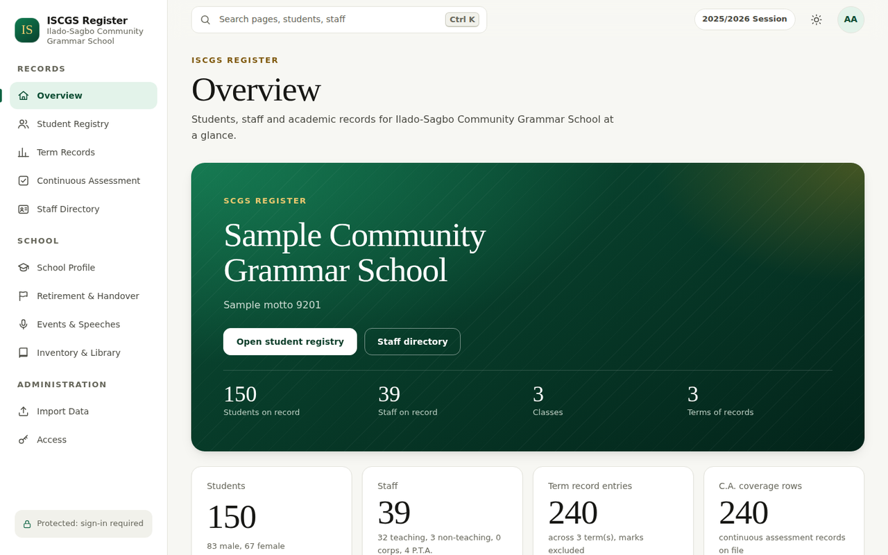
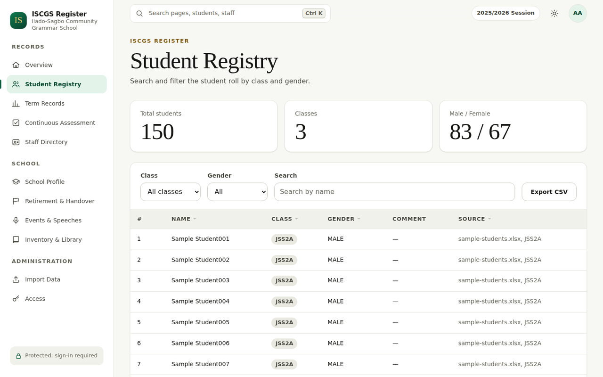
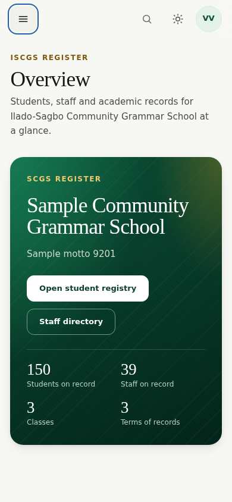

<p align="center">
  <picture>
    <source media="(prefers-color-scheme: dark)" srcset="docs/assets/logo-dark.svg">
    
  </picture>
</p>

<p align="center"><strong>A private, secure register of students, staff and records for Ilado-Sagbo Community Grammar School.</strong></p>

<p align="center">
  <a href="https://github.com/babatundeawo/ilado-school-dashboard/actions/workflows/deploy.yml"></a>
  <a href="https://github.com/babatundeawo/ilado-school-dashboard/actions/workflows/codeql.yml"></a>
</p>

<p align="center">
  <a href="https://babatundeawo.github.io/ilado-school-dashboard/">Live site</a> ·
  <a href="docs/">Documentation</a> ·
  <a href="https://github.com/babatundeawo/ilado-school-dashboard/issues/new/choose">Report an issue</a>
</p>

<p align="center">
  
</p>

## About

ISCGS Register brings the school's student roll, staff directory, attendance and assessment coverage, school profile and inventory into one place. It is built for the school's administrators and staff, who need quick, searchable access to records without passing them around as spreadsheets.

Records are stored in a protected database, not on the public website. Everyone signs in, and only people approved by a school administrator can see anything.

## Features

- **Student Registry:** search and filter the roll by class and gender; export a CSV.
- **Term Records:** attendance and subject coverage by class and term.
- **Continuous Assessment:** whether each student has a record on file for the term.
- **Staff Directory:** teaching, non-teaching, corps and P.T.A.-appointed staff, with a detail panel and Google Contacts export.
- **School Profile, Retirement & Handover, Events & Speeches, Inventory & Library:** the school's history, governance and property records.
- **Search anywhere:** press `Ctrl K` (or `⌘ K`) to jump to a page, student or staff member.
- **Light and dark themes**, a layout that works from small phones to wide desktop screens, and keyboard and screen-reader support.
- **Administrator tools:** approve or decline sign-in requests and load records from Excel workbooks.

Assessment marks and examination scores are intentionally not stored or shown anywhere.

## How to use it

1. Open the [live site](https://babatundeawo.github.io/ilado-school-dashboard/) and choose **Create account** with your name, email and a password.
2. Open the verification link emailed to you, then return to the site.
3. Wait for an administrator to approve your request. Once approved, the register opens.
4. Use the sidebar to move between sections and the table filters to narrow results. You are signed out automatically after a period of inactivity.

<p align="center">
  
  
</p>

## Tech stack

- HTML, CSS and JavaScript modules, with no front-end framework
- Firebase Authentication and Cloud Firestore, protected by security rules
- GitHub Actions for build, checks and deployment to GitHub Pages
- Playwright for end-to-end tests

## Project structure

```text
.github/        Workflows (deploy, checks, CodeQL), Dependabot, issue and PR templates
docs/           Owner guides and README images
firebase/       Firestore security rules
scripts/        Dependency-free build and check scripts
src/            Page templates, styles and JavaScript modules
tests/          End-to-end tests, Firebase test doubles and a fictional sample dataset
site.config.json  Page list, titles and school details
```

## Contributing

Report a bug or suggest an idea through [Issues](https://github.com/babatundeawo/ilado-school-dashboard/issues/new/choose), or open a pull request from the GitHub website. See [CONTRIBUTING.md](CONTRIBUTING.md) for details. Never include real student or staff information in an issue, pull request or screenshot.

## Security

Please report vulnerabilities privately; see [SECURITY.md](SECURITY.md).

## License and credits

No open-source licence has been applied; please ask the maintainers before reusing this code. Typefaces: [Instrument Serif](https://fonts.google.com/specimen/Instrument+Serif) and [Figtree](https://fonts.google.com/specimen/Figtree), both under the SIL Open Font License. Spreadsheet import uses [SheetJS Community Edition](https://sheetjs.com/) (Apache-2.0). Icons are drawn for this project. Screenshots use fictional sample data.

Owner guides: [Deployment](docs/DEPLOYMENT.md) · [Customizing](docs/CUSTOMIZING.md) · [Firebase login setup](docs/FIREBASE_LOGIN_SETUP.md)
